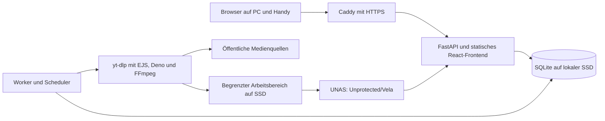

# Vela: Architektur und Entscheidungsgrundlage

Stand: 2. November 2026. Version: **1.0.0**. API, Worker, Oberfläche, Tests und Bereitstellungsskripte sind implementiert. Ein erfolgreicher Produktivstart wird hier noch nicht behauptet; Einrichtung und Abnahme beschreibt [operations.md](operations.md).

Vela überführt öffentliche Medienlinks in Dateien auf dem Heimserver beziehungsweise UNAS. Der Eigenbau konzentriert sich auf Bedienung, dauerhafte Auftragszustände, Speicherung und Betrieb. Die Extraktion übernimmt weiterhin yt-dlp. Der Aufbau ist für einen privaten Haushalt und einen Linux-Host mit überschaubarer Parallelität ausgelegt.

## Entscheidungsgrundlage

Das Repository war zu Beginn leer. Die lesende Serverprüfung am 2. November 2026 gegen 16:27 MEZ ergab Debian 13.7 auf x86_64, einen Intel Core i7-7700 mit vier Kernen/acht Threads, rund 7,65 GiB nutzbaren RAM und rund 123 GiB freien lokalen ext4-Speicher. Rund 3,26 GiB RAM waren verfügbar; belegter Swap allein belegte keinen aktuellen Leistungsengpass. Die Werte sind eine datierte Ausgangsmessung, kein Lasttest.

Luma, Orbit, Paperless, Caddy/NEXUS und Kameradienste teilen den Host. Luma verwendet bereits FastAPI und React/Vite. Daraus folgen eine gemeinsame Werkzeugbasis, begrenzte Parallelität und der Verzicht auf zusätzliche Datenbank- und Queue-Server.

MeTube liefert die Funktionsreferenz für Linkeingabe, Profile, Playlists und Fortschritt. Es unterstützt bereits Kanalabos und persistierten Zustand. Sein Stack verwendet Python/aiohttp und Socket.IO sowie Angular/TypeScript. Downloads laufen in Multiprocessing-Prozessen, Metadatenextraktion dagegen über Executor-Threads im Hauptprozess; URLs dienen als Queueschlüssel. Der Hauptspeicher ist inzwischen JSON mit atomischem Austausch. Vela verwendet eigene Job-IDs, transaktionalen Zustand und Prozessgrenzen auch für Vorschauen. [MeTube](https://github.com/alexta69/metube), [Abhängigkeiten](https://github.com/alexta69/metube/blob/master/pyproject.toml), [Downloadverwaltung](https://github.com/alexta69/metube/blob/master/app/ytdl.py), [Zustandsspeicher](https://github.com/alexta69/metube/blob/master/app/state_store.py)

MeTube dokumentiert Grenzen seines SSRF-Schutzes, unter anderem für Metadaten-Redirects und native Netzwerkbibliotheken. Ein anderer Webframework-Stack behebt solche Grenzen nicht; zusätzlich zur URL-Prüfung ist eine Netzgrenze unterhalb der Engine erforderlich. [MeTube-URL-Schutz](https://github.com/alexta69/metube/blob/master/app/url_guard.py)

| Bewertete Variante | Einordnung für Vela |
| --- | --- |
| Python/FastAPI und React/Vite | Gewählt: Nähe zu yt-dlp, vorhandene Werkzeuge, statisches Browserfrontend |
| Go und React/Vite | Geeigneter Controller; zusätzliche Sprache, während Python/Deno/FFmpeg weiter benötigt werden |
| TypeScript/Node und React | Geeignete Alternative bei überwiegender TypeScript-Wartung; die externe Engine bleibt |
| Rust/Axum und React | Gute Prozesskontrolle, für diesen Umfang kein nachgewiesener Mehrwert gegenüber dem Implementierungsaufwand |
| SvelteKit | Ein statisch gebautes Svelte-Frontend wäre geeignet; SSR bringt dem privaten Dashboard wenig |

Alle betrachteten Backends können externe Prozesse steuern. Netzwerk, Datenträger und Medienverarbeitung bestimmen die Gesamtleistung wesentlich; ein allgemeiner Geschwindigkeitsvorteil einer Sprache wurde nicht gemessen. [Python](https://docs.python.org/3/library/asyncio-subprocess.html), [Go](https://pkg.go.dev/os/exec), [Node](https://nodejs.org/api/child_process.html), [Tokio](https://docs.rs/tokio/latest/tokio/process/index.html)

## Implementierter Aufbau

Das Diagramm zeigt den vorgesehenen Produktivaufbau, keine bestätigte Erreichbarkeit. Zwei Compose-Dienste ersetzen weder Netzregeln noch Mount-Berechtigungen.

**API:** FastAPI liefert REST, SSE und die gebauten Browserdateien. Es startet keine Downloader. Auf ausdrücklichen Nutzerwunsch gibt es keine Anmeldung, Konten oder Anwendungssitzungen; der Zugang ist ausschließlich für das vertrauenswürdige Heimnetz vorgesehen. Alle dort zugelassenen Nutzer können Aufträge und Dateien abrufen. Host- und Origin-Prüfung bleiben erhalten, damit fremde Webseiten keine schreibenden Browseranfragen auslösen können. Dateidownloads verwenden Artefakt-IDs und geprüfte Pfade. Ein zusätzlicher Frontend-Laufzeitserver ist nicht erforderlich.

**Worker:** Ein exklusiver Worker übernimmt Jobs aus SQLite. Ein Download und ein separater Vorschauauftrag können gleichzeitig laufen. Auch Playlistauflösung läuft über die Engine. Jeder Vorgang erhält Arbeitsbereich, strukturierte Ausgabe, Zeit-/Ausgabelimits und Prozessgruppe; Abbruch erfasst auch FFmpeg. Der Worker veröffentlicht keinen HTTP-Port.

**Oberfläche:** Die deutsche React-Anwendung bietet Linkeingabe, Vorschau, Profile, Auflösung, Playlist-Einträge, Warteschlange, Fortschritt, Abbruch, Wiederholen fehlgeschlagener/abgebrochener Aufträge, Verlauf mit Suche/Filtern, Dateidownload sowie Speicher-/Serverstatus. SSE löst gebündelte Aktualisierungen aus; Polling ergänzt den Stream. Externe Thumbnail-URLs werden nicht im Browser geladen.

## Zustand und Wiederanlauf

SQLite liegt lokal und verwendet WAL, `synchronous=FULL`, kurze Transaktionen und `busy_timeout`. API und Worker teilen den vollständigen Datenbankordner einschließlich WAL/SHM; die aktive Datenbank liegt nicht auf SMB/NFS. Das Containerimage liefert SQLite 3.51.3 mit WAL-reset-Fix und prüft dessen Version. [SQLite WAL](https://sqlite.org/wal.html), [synchronous](https://sqlite.org/pragma.html#pragma_synchronous)

Die Auftragsdaten liegen in `jobs`, `artifacts`, `events` und `settings`. Ein Job besitzt eine UUID unabhängig von der URL, Profil, Zustände und Versuchszähler. Idempotenzschlüssel verhindern doppelte Übernahme wiederholter Requests; eine allgemeine inhaltsbasierte Duplikaterkennung über verschiedene Links ist noch nicht vorhanden.

Der Ablauf lautet `queued → probing → downloading → postprocessing → finalizing → completed`; Fehler, Abbruch, Unterbrechung und Warten auf Speicher besitzen eigene Zustände. Playlists erzeugen begrenzte Einzelaufträge. Ihr übergeordneter Auftrag gilt nach Übernahme der Einträge als abgeschlossen, nicht erst nach sämtlichen Dateidownloads. Standardmäßig werden höchstens 100 Einträge aufgelöst.

Ein Dateilock schützt den Scheduler. Beim Neustart gleicht der Worker aufgezeichnete Prozessidentitäten ab, bevor er unterbrochene Jobs wieder einreiht. Teil-Dateien können genutzt werden; nicht jede Quelle oder unterbrochene Nachbearbeitung lässt sich nahtlos fortsetzen. [yt-dlp-Dateioptionen](https://github.com/yt-dlp/yt-dlp#filesystem-options)

Ein dauerhaftes Abschlussprotokoll geht NAS-Schreibvorgängen voraus. Dateien werden vorläufig kopiert, auf Größe und SHA-256 geprüft und anschließend umbenannt. Wiederholung erkennt identische veröffentlichte Dateien. Bei fehlendem Ziel oder Platz wartet die Finalisierung und wird erneut versucht. Datenbank und Dateisystem bilden keine gemeinsame Transaktion; eine allgemeine Exactly-once-Garantie wird nicht behauptet.

## Engine und Profile

Das Workerimage bündelt yt-dlp mit EJS, Deno und FFmpeg/ffprobe. YouTube benötigt heute Challenge-Skripte und eine unterstützte JavaScript-Runtime; deren Vorhandensein garantiert keine dauerhafte Plattformverfügbarkeit. Die Engine wird im Image festgelegt, nicht durch Selbstupdates eines laufenden Containers verändert. [yt-dlp EJS](https://github.com/yt-dlp/yt-dlp/wiki/EJS)

| Profil | Implementiertes Verhalten |
| --- | --- |
| Original | Beste passende Streams bis zur gewählten Höhe; Zusammenführen ohne erzwungene Neukodierung |
| Kompatibel | H.264/AAC als MP4; fehlt eine passende Quelle, entsteht ein Fehler statt automatischer Neukodierung |
| Nur Audio | Beste Audiospur und Audioextraktion im passenden Format; keine feste MP3-Konvertierung |

Die Oberfläche bietet 480p, 720p, 1080p und 2160p. Ein Containerformat allein legt den Codec nicht fest. GPU-Transcoding gehört nicht zum aktuellen Umfang. [FFmpeg Streamcopy](https://ffmpeg.org/ffmpeg.html#Streamcopy)

## Speicherung und Betriebsgrenzen

Das gewünschte Ziel ist `\\unas.home.arpa\Unprotected\Vela`. Vela nutzt einen eigenen Unterordner; bestehende Medien anderer Anwendungen sind kein Arbeitsbereich. Die fehlende Redundanz ist bewusst akzeptiert. Medienbackups sind nicht Bestandteil des Auftrags.

Die Bereitstellung verwendet `/srv/vela/state` für SQLite, `/srv/vela/work` als SSD-Arbeitsbereich und `/srv/vela/library/Vela` als eingebundenes Ausgabeziel. Ein Volumenmarker verhindert, dass Vela ein fehlendes NAS durch einen neu angelegten lokalen Ausgabeordner ersetzt. Die API erhält Medien nur lesend; Schreibzugriff liegt beim Worker.

Der Worker überwacht Arbeitsbudget und freie Reserve. Die Bereitstellung ergänzt das überwachte Budget durch ein begrenztes Arbeitsvolume. Compose sieht 256 MiB/0,5 CPU für die API und 1 GiB/eine CPU für den Worker vor; das sind konservative Einstellungen, kein gemessenes Kapazitätsversprechen.

Die Container laufen ohne Root, ohne Docker-Socket und mit begrenzten Schreibbereichen. Vela benötigt keine Anwendungspasswörter oder Sitzungsschlüssel. Der Reverse Proxy begrenzt den Zugang auf das vertrauenswürdige Heimnetz; es gibt keine öffentliche Freigabe. URL-Prüfung und feste Profile ersetzen keine Egress-Regeln: Workerzugriffe auf private Netze, Hostdienste, Link-local und entsprechende IPv6-Ziele müssen netzseitig blockiert werden. Ein Docker-Bridgenetz allein leistet das nicht. Bereitstellungsskripte richten die vorgesehenen Grenzen ein; ihre Wirksamkeit ist beim Produktivstart zu prüfen. [Docker-Firewall](https://docs.docker.com/engine/network/firewall-iptables/)

## Bereitstellung, Prüfung und Erweiterungen

Vela läuft unter **https://vela.home.arpa** am vorhandenen Caddy und ist in NEXUS verlinkt. Containerbuild, Mount-/Startprüfung, Netzregeln, DNS/TLS und echte Downloads bis zum UNAS sind geprüft; Einzelheiten stehen in der [Abnahme](verification.md). Die Bereitstellung erfolgt direkt auf dem Heimserver. Eine Orbit-Veröffentlichung findet ausschließlich auf ausdrücklichen Nutzerauftrag statt.

Die lokale Prüfung verwendet `python -m pytest` sowie im Frontend `npm test` und `npm run build`; Voraussetzungen stehen im [README](../README.md). Tests decken unter anderem Host-/Origin-Prüfung, direkten Zugang ohne Anmeldung, Queue, Abbruch, Wiederanlauf, Speicherprüfung und Browser-Arbeitsabläufe ab. Plattformtests mit realen Quellen bleiben zusätzlich erforderlich.

Noch nicht enthalten sind Kanalabonnements, Cookies-/PO-Token-Verwaltung, Untertitel-/Thumbnailprofile, Medienlöschung, automatische Medienbackups und Browser-/Teilen-Integrationen. Diese Punkte sind spätere Erweiterungen. PostgreSQL oder ein Broker werden erst bei mehreren Workerhosts beziehungsweise nachgewiesener hoher Schreibkonkurrenz neu bewertet.
